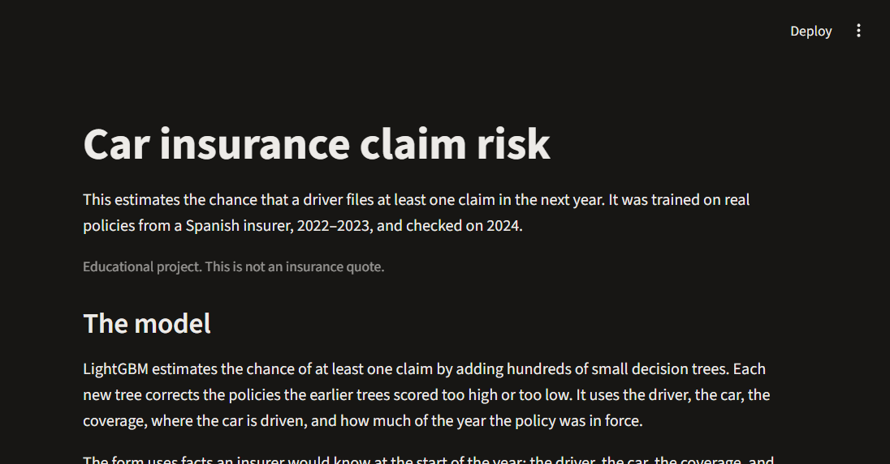

# Predicting Next-Year Car Insurance Claims

**Senior project · Data Science major, Statistics minor**

Which drivers are most likely to file a car insurance claim next year? This project models the probability that a policy has at least one claim in the coming year, using three years of real, anonymised policy data from a Spanish motor insurer (2022–2024). It compares a traditional actuarial GLM with a gradient boosting model and turns the final model into a small web app where anyone can enter driver and vehicle details and see an estimated claim probability.

> 🚧 **Status:** in progress. Results and app link will be added as the project develops.

---

## Live app

🔗 _Link coming soon (Streamlit Community Cloud)_

<!-- Add a screenshot once the app is running:

-->

---

## Data

- **Source:** Espinosa, P., Lledó, J., & Atance del Olmo, D. (2026). *A detailed dataset of motor insurance policies with coverage-specific financial information.* Mendeley Data, V1. https://doi.org/10.17632/sw4jmdb2sm.1
- **Coverage:** anonymised policies from a Spanish insurer, January 2022 – December 2024
- **Size:** about 354,000 policy-year observations and 47 variables (policy, driver, vehicle, premiums, exposure, claims by coverage)

The raw data is **not** included in this repository. See [`data/README.md`](data/README.md) for download instructions.

---

## Approach

| Step | What | Where |
|---|---|---|
| 1. Data prep | Clean data, derive ages from dates, define the claim target | `src/data_prep.py`, `notebooks/01_eda.ipynb` |
| 2. Exploration | Exposure-weighted claim rates by risk factor | `notebooks/01_eda.ipynb` |
| 3. Modeling | Binomial GLM (cloglog link, exposure offset) vs. LightGBM | `src/train.py`, `notebooks/02_modeling.ipynb` |
| 4. Evaluation | AUC, Gini, lift, calibration, SHAP, fairness check, risk tiers | `src/evaluate.py`, `notebooks/03_evaluation.ipynb` |
| 5. App | Streamlit form → predicted claim probability and risk tier | `app/app.py` |

**Validation design:** models are trained on 2022–2023 and tested on 2024 (out-of-time), which mirrors how an insurer would actually use the model and avoids leakage from the same policy appearing in both sets.

---

## Key results

_To be completed._

| Model | Test AUC | Gini | Notes |
|---|---|---|---|
| GLM (cloglog) | – | – | |
| LightGBM | – | – | |

---

## Repository structure

```
predictNextClaim/
├── README.md
├── requirements.txt
├── data/
│   ├── raw/              # downloaded dataset (not committed)
│   ├── processed/        # cleaned data (not committed)
│   └── README.md         # how to get the data
├── notebooks/
│   ├── 01_eda.ipynb
│   ├── 02_modeling.ipynb
│   └── 03_evaluation.ipynb
├── src/
│   ├── config.py         # paths, column names, settings
│   ├── data_prep.py      # cleaning, features, target, year split
│   ├── train.py          # fits and saves models
│   ├── evaluate.py       # Gini, lift, calibration helpers
│   └── predict.py        # loads the model, returns a probability
├── models/               # saved model (claim_model.joblib)
├── app/
│   └── app.py            # Streamlit UI
└── reports/
    └── figures/
```

---

## How to run

```bash
# 1. Set up the environment
python -m venv .venv
source .venv/bin/activate        # Windows: .venv\Scripts\activate
pip install -r requirements.txt

# 2. Put the downloaded dataset in data/raw/ (see data/README.md)

# 3. Prepare data and train
python -m src.data_prep
python -m src.train

# 4. Launch the app
streamlit run app/app.py
```

---

## Author

**Ange Konan** · [GitHub](https://github.com/angekonan715)

_This is an educational project. Predictions are not insurance quotes._
