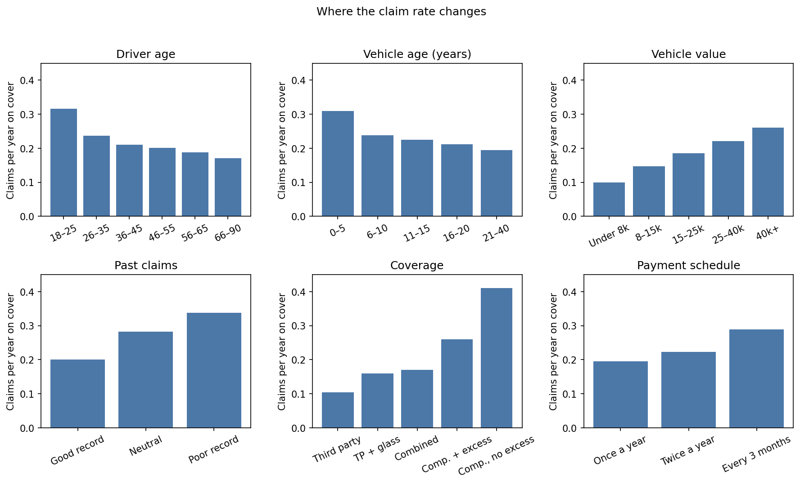
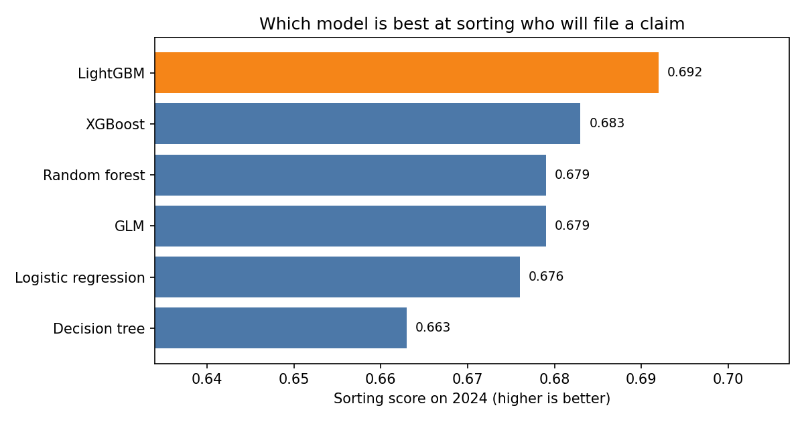
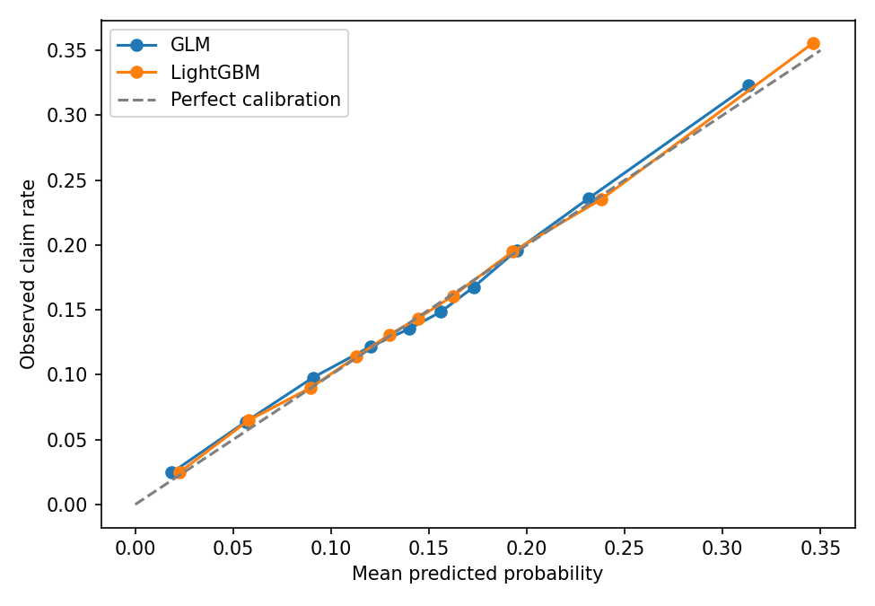
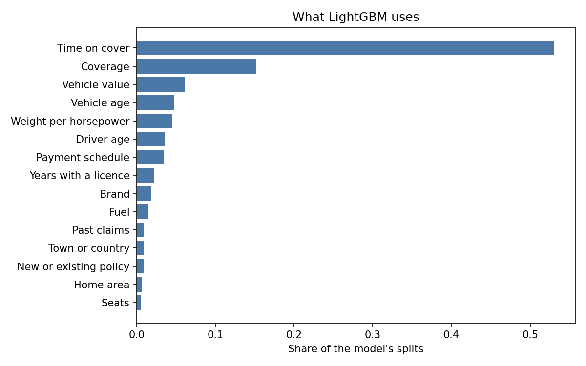

# Predicting Next-Year Car Insurance Claims

**Senior project · Data Science major, Statistics minor**

Which drivers are most likely to file a car insurance claim next year? This project estimates the probability that a policy has at least one claim, using three years of real, anonymised policy data from a Spanish motor insurer (2022–2024). It compares a formula (GLM), a logistic regression, a decision tree, a random forest, XGBoost, and LightGBM. LightGBM is the model in the web app.

> The app, the notebooks, and the write-up are in place. Predictions are a study result, not an insurance quote.

---

## Live app

https://angekonan715-predictnextclaim-appapp-vz9rsh.streamlit.app/


---

## Data

- **Source:** Espinosa, P., Lledó, J., & Atance del Olmo, D. (2026). *A detailed dataset of motor insurance policies with coverage-specific financial information.* Mendeley Data, V1. https://doi.org/10.17632/sw4jmdb2sm.1
- **Coverage:** anonymised policies from a Spanish insurer, January 2022 – December 2024
- **Size:** about 354,000 policy-year observations and 47 variables (policy, driver, vehicle, premiums, exposure, claims by coverage)

The raw data is **not** included in this repository. See [`data/README.md`](data/README.md) for download instructions.

---

## Approach

| Step | What | Where |
|---|---|---|
| 1. Data prep | Drop unusable rows, cap vehicle value, group rare brands, define the claim target | `src/data_prep.py`, `notebooks/01_eda.ipynb` |
| 2. Exploration | Exposure-weighted claim rates by risk factor | `notebooks/01_eda.ipynb` |
| 3. Modeling | GLM, logistic regression, decision tree, random forest, XGBoost, LightGBM | `src/train.py`, `notebooks/02_modeling.ipynb` |
| 4. Evaluation | AUC, Gini, calibration, and risk tiers on 2024 | `src/evaluate.py`, `notebooks/03_evaluation.ipynb` |
| 5. App | Streamlit form → predicted claim probability and risk tier | `app/app.py` |

**Validation design:** models are trained on 2022–2023 and tested on 2024 (out-of-time), which mirrors how an insurer would actually use the model and avoids leakage from the same policy appearing in both sets.

---

## Key results

The models learned from 2022 and 2023, then were tested on 2024. A higher AUC means the model is better at putting drivers who claimed above drivers who did not. A smaller calibration gap means the predicted percentage is close to what really happened.

| Model | Test AUC | Gini | Calibration gap |
|---|---|---|---|
| GLM | 0.679 | 0.359 | 0.005 |
| Logistic regression | 0.676 | 0.352 | 0.008 |
| Decision tree | 0.663 | 0.326 | 0.005 |
| Random forest | 0.679 | 0.359 | 0.019 |
| XGBoost | 0.683 | 0.366 | 0.003 |
| **LightGBM** | **0.692** | **0.384** | **0.003** |

LightGBM is the saved model. It adds hundreds of small trees, and each new tree corrects the policies the earlier trees got wrong. About half of its splits use time on cover. The app fixes that at one full year. After that, coverage, vehicle value, and vehicle age move the score the most.

The claim rate itself is highest for younger drivers, newer cars, more expensive cars, broader cover, and a poor past-claims record. Details, the calibration and lift charts, and the fairness check are in [`reports/final_report.md`](reports/final_report.md). A one-page version is [`reports/executive_summary.md`](reports/executive_summary.md). Slides are [`reports/presentation.pptx`](reports/presentation.pptx).









---

## Repository structure

```
predictNextClaim/
├── README.md
├── requirements.txt
├── data/
│   ├── raw/              # downloaded dataset (not committed)
│   ├── processed/        # cleaned data (not committed)
│   └── README.md         # how to get the data
├── notebooks/
│   ├── 01_eda.ipynb
│   ├── 02_modeling.ipynb
│   └── 03_evaluation.ipynb
├── src/
│   ├── config.py         # paths, column names, settings
│   ├── data_prep.py      # cleaning, features, target, year split
│   ├── train.py          # fits and saves models
│   ├── evaluate.py       # Gini, lift, calibration helpers
│   └── predict.py        # loads the model, returns a probability
├── models/               # saved model (claim_model.joblib)
├── app/
│   └── app.py            # Streamlit UI
└── reports/
    └── figures/
```

---

## How to run

```bash
# 1. Set up the environment
python -m venv .venv
source .venv/bin/activate        # Windows: .venv\Scripts\activate
pip install -r requirements.txt

# 2. Put the downloaded dataset in data/raw/ (see data/README.md)

# 3. Prepare data and train
python -m src.data_prep
python -m src.train

# 4. Launch the app
streamlit run app/app.py
```

---

## Author

**Ange Konan** · [GitHub](https://github.com/angekonan715)

_This is an educational project. Predictions are not insurance quotes._
